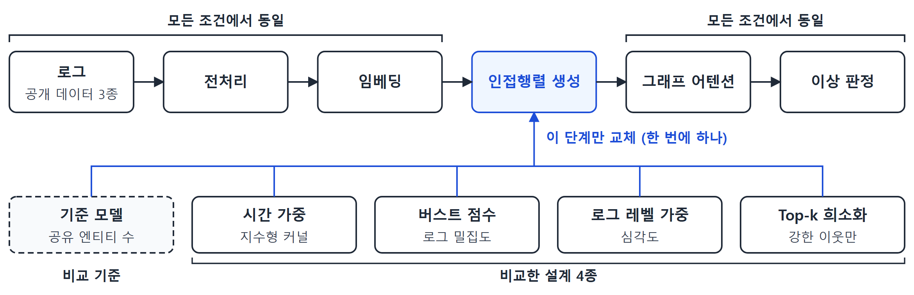

# 박길수

**ML / MLOps 엔지니어 · 보안과 로그 이상탐지**

시스템 로그와 네트워크 로그의 이상탐지 모델을 만들었고 
네트워크 로그는 수집부터 분석가 화면까지 한 파이프라인으로 연결했습니다.

 

---

## 소개

공공기관 웹 시스템을 유지보수하며 로그를 읽던 경험을 계기로 석사 과정에서 그래프 기반 로그 이상탐지를 연구했습니다. 지금은 보안 운영을 배우면서 Zeek 네트워크 로그의 이상탐지 파이프라인을 만들고 있습니다. 이 파이프라인의 문제 정의, 평가 방법, 배포 구조를 설계했습니다.

| 시⁠기 | 내용 |
| --- | --- |
| 학⁠부 | 경영정보학을 전공해 프로그래밍, 데이터베이스 모델링, 시스템 분석과 설계를 배웠습니다. |
| 2⁠0⁠1⁠9 ~ 2⁠0⁠2⁠2 | 공공기관의 전자정부프레임워크(Spring, MyBatis) 시스템을 3년 3개월 유지보수했습니다. 내부망에서 WEB 서버와 WAS(JBoss)가 분리된 환경이었고 형상 관리는 SVN으로 했습니다. 기능 수정, 신규 게시판 개발, SQL 수정이 주된 일이었습니다. 접속이 몰리는 날에는 서버 자원 추이와 WAS 로그, 에러 로그를 확인했습니다. |
| 석⁠사 | 국민대학교 일반대학원에서 데이터사이언스를 전공했습니다. 로그의 발생 시점, 밀집도, 심각도를 그래프의 연결 강도에 반영한 설계를 세 데이터셋에서 비교했습니다. |
| 지⁠금 | SKT ALEPH 과정(K-뉴딜 아카데미, 2026년 12월까지)에서 보안 운영을 배웁니다. 과정 실습 코드는 [security-agent-toolkit](https://github.com/prosild/security-agent-toolkit)에 있습니다. |

---

## 대표 프로젝트

### Zeek 네트워크 로그 이상탐지와 LLM 조사 에이전트 (zeek_AD)

rule로는 잡기 어려운 내부망의 행동 이상(정찰, 측면 이동, beaconing, 느린 유출)을 Zeek 로그에서 찾아 분석가가 조사할 순서를 매기는 시스템입니다. 정상 트래픽만 학습한 통계 베이스라인, Transformer, 시간 그래프 모델이 각각 점 이상, 문맥 이상, 관계 이상을 맡습니다. 상위 건에는 LLM 에이전트가 근거와 MITRE ATT&CK 기법 후보를 붙입니다.

문제 정의, 모델 구성, 평가 방법, 파이프라인 구조는 직접 설계했고 구현에는 AI 코딩 에이전트(Claude Code, Codex)를 활용했습니다. Transformer 모델, 그리고 시간 그래프 모델의 엣지 인코더, 임베딩, 디코더, 손실은 Jupyter 노트북에서 직접 작성했습니다.

| 항⁠목 | 내용 |
| --- | --- |
| 기⁠간 | 2026.11 ~ 현재 |
| 저⁠장⁠소 | [zeek_AD](https://github.com/prosild/zeek_AD) (탐지, 조사 에이전트), [zeek_ad_dashboard](https://github.com/prosild/zeek_ad_dashboard) (관제 대시보드) |
| 데⁠모 | [soc.psdev93.synology.me](https://soc.psdev93.synology.me) 읽기 전용 계정 `demo` / `WTYdSaRDUfjT3jr9cAw2` |

세 모델을 결합하면 공개 데이터(CIC-IDS-2017)의 공격 사건 16건 중 14건, APT 합성 패턴 20건 중 13건이 하루 상위 50건에 들었습니다. 합성 패턴 가운데 통계 베이스라인이 나흘 내내 놓친 HTTPS beaconing은 시간 그래프 모델이 사흘 동안 상위 50에 올렸습니다. 베이스라인이 하루만 올린 측면 이동은 Transformer가 나흘 모두 올렸습니다. 순위를 번갈아 뽑는 방식이라 상위 10건에서는 단일 모델 최고치보다 낮았습니다.

이어서 VMware 격리 실습망에서 Kali와 대상 VM으로 공격 7종의 트래픽을 한두 번씩 발생시켜 모델이 무엇을 보고 무엇을 놓치는지 확인했습니다. 포트 스캔과 측면 이동처럼 여러 포트나 주소로 퍼지는 연결은 잡았고 측면 이동에서는 시간 그래프 모델도 임계값을 넘겼습니다. 한 포트에 연결이 몰리는 무차별 대입과 DNS 터널은 놓쳤고 합성 평가에서 시간 그래프 모델이 올렸던 beaconing도 실습망에서는 놓쳤습니다. 다음에는 주기성과 호스트 쌍 단위 집계를 특징으로 더합니다.

| 고민한 문제 | 선택 | 대가 |
| --- | --- | --- |
| 공격 대부분이 방화벽의 NAT 주소 하나에서 들어와 그 주소와의 연결 수로만 정렬해도 공격이 상위에 오름 | 이 정렬을 진단용 비교 기준으로 두고 모델이 주소에 얼마나 기대는지 측정 | 공개 데이터 수치로는 모델 우열을 가리지 않음 |
| 운영 환경에는 공격 라벨이 없고 분석가가 하루에 볼 수 있는 건수는 한정됨 | 정상 트래픽 하루치만 학습하고 F1 대신 상위 10건, 50건 안에 든 공격 사건 수(Recall@N)로 평가 | 전체 후보 중 오탐이 얼마나 되는지는 이 지표에 드러나지 않음 |
| 운영에는 라벨이 없어 평가 때와 계산이 달라져도 모름 | 모델, 전처리, 임계값, 코드 해시를 배포 묶음 하나로 만들고 평가 점수가 재현될 때만 MLflow Registry에 등록 | 배포 전의 재현까지만 보장하고 운영 중 드리프트 감시는 하지 않음 |

모델별 결과와 나머지 설계 판단

 

Recall@N은 날마다 조사 후보 약 250건 중 상위 N건 안에 든 공격 사건 수를 전체 사건 수로 나눈 값입니다. 모델 가운데 가장 높은 값을 굵게 표시했습니다. 표본이 작아 모델 간 차이는 확정할 수 없습니다.

| 순위 기준 | 공개 @10 | 공개 @50 | APT 합성 @10 | APT 합성 @50 |
| --- | ---: | ---: | ---: | ---: |
| 통계 베이스라인 | 8/16 | 13/16 | **7/20** | 11/20 |
| Transformer | 8/16 | 11/16 | 4/20 | 11/20 |
| 시간 그래프 | **11/16** | 13/16 | 2/20 | 9/20 |
| 세 모델 결합 | 8/16 | **14/16** | 5/20 | **13/20** |
| NAT 주소 연결 수 (진단용) | 12/16 | 13/16 | 해당 없음 | 해당 없음 |

- 공개 데이터 상위 10에서는 NAT 진단 기준이 모든 모델보다 높았습니다. APT 합성 패턴은 내부 자산에서 출발하므로 이 편향과 무관합니다.
- APT 합성 상위 10에서는 통계 베이스라인이 가장 높았습니다. 베이스라인이 대부분 놓친 합성 beaconing과 측면 이동을 딥러닝 모델 둘이 올려서 두 모델을 유지했습니다.
- 놓친 XSS와 SQL 인젝션은 요청 내용에 드러나는 공격이라 URI와 페이로드를 보는 탐지와 함께 써야 합니다.

| 고민한 문제 | 선택 | 대가 |
| --- | --- | --- |
| CIC-IDS-2017의 CSV는 관제에서 쓰는 센서의 출력이 아니고 프로토콜 로그를 근거로 쓸 수도 없음 | 원본 PCAP 5일치를 Zeek로 다시 처리 | 공격 사건 16건의 정답을 다시 구성 |
| 5분 단위로 집계하면 연결 상대가 사라짐 | 연결 하나하나를 이벤트로 다루는 시간 그래프 모델(TGN 구조)을 추가 | IP를 입력으로 쓰는 모델이라 NAT 주소에 기댐. NAT 연결을 빼면 공개 데이터 상위 10이 11/16에서 6/16으로 내려감 |
| 세 모델의 점수는 분포의 꼬리 모양이 달라 정규화해서 섞으면 한 모델이 상위를 거의 독차지함 | 점수를 섞지 않고 순위를 번갈아 뽑아 결합(round-robin) | 상위 N 자리가 모델 수만큼 나뉨 |

Zeek는 연결이 끝난 뒤에 기록을 남깁니다. 연결 시작 시각으로 윈도우를 나누면 그 시점에는 없던 기록이 섞이므로 기록 시각을 기준으로 5분 윈도우를 나눴습니다. 공개 데이터의 공격은 대부분 시끄러운 스크립트 공격이어서 조용히 오래가는 APT 합성 패턴 5종 20건을 실제 배경 로그에 주입해 따로 평가했고 패턴 설정은 모델 점수를 보기 전에 고정했습니다.

실습망에서 재현한 공격 7종

 

처음에는 Kali 포트 스캔 하나로 수집부터 탐지, 보고서까지 5분 주기로 자동 실행되는 것을 확인했습니다. 그 뒤 배포 VM을 실습망 세그먼트 전체를 보는 센서로 쓰고 공격 대상 VM을 추가해 나머지 공격을 하나씩 실행했습니다. 공격마다 시간대와 포트를 달리했고 공격한 쪽과 당한 쪽의 윈도우가 임계값을 넘는지, beaconing은 정상 구간보다 점수가 오르는지도 봤습니다. 모델은 실습망 데이터로 다시 학습하지 않았습니다.

| 공격 | 5분 윈도우에 남는 모양 | 결과 |
| --- | --- | --- |
| 포⁠트 스⁠캔 (빠⁠름⁠, 느⁠림) | 여러 포트로 퍼지는 연결 | 탐지. 윈도우당 약 60포트로 늦춰도 Transformer가 높게 올림 |
| 측⁠면 이⁠동 | 한 호스트가 내부 주소 4개의 SMB에 연결 | 탐지. 시간 그래프 모델까지 세 모델 모두 임계값을 넘김 |
| 느⁠린 유⁠출 | 연결 하나에 큰 전송량(4MB) | 임계값을 조금 넘김 |
| 무⁠차⁠별 대⁠입 | SSH 한 포트에 연결 300건 | 놓침 |
| beaconing | 한 상대에 약 1분 간격의 짧은 연결 | 놓침 |
| D⁠N⁠S 터⁠널 | 긴 이름의 DNS 질의 다수 | 놓침 |

beaconing은 정상 통신만 있는 구간과 견줘도 세 모델 모두 점수가 오르지 않았습니다. 합성 평가(5분에 연결 하나)와는 간격이 다르고(약 1분) 실습망 호스트는 학습 이력이 없는 새 자산이어서 두 결과를 수치로 견주지는 않았습니다. 공격마다 한두 번 실행한 정성 확인이며 다음에는 주기성과 호스트 쌍 단위 집계를 특징으로 더하고 같은 공격으로 다시 확인합니다.

LLM 조사 에이전트와 배포

 

LLM은 탐지에 쓰지 않고 상위 후보를 조사하는 데만 씁니다. 근거 수집, ATT&CK 기법 검색, 보고서 작성 순서로 LangGraph에 구성했습니다. ATT&CK 검색은 같은 질의 16개로 BM25와 임베딩 검색(pgvector)을 비교해 hit@5가 높은 임베딩을 골랐습니다(0.750 대 0.938).

- 도메인이나 URI처럼 공격자가 조작할 수 있는 문자열은 간접 프롬프트 인젝션 경로가 되므로 LLM에 넘기지 않습니다. 실제 IP는 외부 API로 나가지 않게 가명 식별자로 바꾸고 허용 목록에 있는 수치만 전달합니다.
- 출력의 수치와 ATT&CK ID는 코드로 입력 근거와 대조해서 어긋나면 템플릿 보고서로 바꿉니다(평가용 30건 중 28건 통과).
- 알림 피로를 줄이려고 어떤 후보를 바로 알릴지 LLM 판단에 맡기는 구조를 시험했습니다. 정해 둔 전송 규칙과 나란히 돌려 보니 알림은 29건에서 16건으로 줄었지만 공격 관련 26건 중 11건이 검토나 보류로 밀려서 전송 규칙을 유지했습니다.

배포 쪽에서는 배포 묶음의 교체, 롤백, 재교체를 실제 추론으로 확인했고 처리 도중에 worker를 강제 종료하는 장애 복구 시험 9건이 모두 통과했습니다. 실시간 처리에는 Spark Structured Streaming 대신 파일 단위 마이크로배치를 써서 평가 때와 같은 배치 스크립트로 그날을 다시 계산합니다. 실습망에서 공격이 몰려 조사 후보가 한꺼번에 늘자 후보마다 LLM을 호출하는 에이전트가 순서대로 처리하면서 뒤 윈도우의 채점까지 밀렸습니다. 채점을 알림, 보고서와 분리하는 일이 남았습니다.

관제 대시보드(Spring Boot)에는 역할별 권한, 마스킹, 감사 로그를 적용했습니다.

---

## 석사 논문 연구

같은 로그 메시지라도 언제 발생했는지, 얼마나 몰려서 나왔는지, 얼마나 심각한지에 따라 뜻하는 시스템 상태가 다릅니다. 그래프 신경망 기반 로그 이상탐지 모델 Lograph는 두 로그가 공유하는 엔티티 수만으로 연결 강도(인접행렬)를 정해서 이런 운영 맥락이 빠지고 연결이 지나치게 촘촘해집니다. 이를 보완하는 인접행렬 설계 네 가지를 PyTorch로 구현하고 여러 작업의 로그가 뒤섞여 기록되는 환경에서 통제 실험으로 비교했습니다.

- 공개 로그 데이터셋 BGL(약 475만 줄), Thunderbird(1,000만 줄 표본), HDFS(약 1,118만 줄)에서 전처리, 임베딩, 모델, 학습 설정을 고정하고 인접행렬 생성 단계만 바꿔 설계별 차이를 비교했습니다.
- 데이터셋마다 기준 모델보다 F1이 높은 설계가 있었습니다(설정마다 한 번 실행한 값). BGL은 시간 가중(0.9268 → 0.9307), Thunderbird는 버스트 점수(0.9580 → 0.9769), HDFS는 Top-k 희소화(0.8174 → 0.8342)가 가장 높았습니다.
- 시간 가중은 세 데이터셋 모두에서 기준 모델보다 높았습니다. 가장 높은 설계는 데이터셋마다 달라서 인접 구조의 효과가 데이터 특성에 좌우된다고 해석했습니다.

zeek_AD와 이 연구는 한 탐지 체계의 두 단계로 구상했습니다. 네트워크 로그에서 이상 행동이 보인 자산을 먼저 찾고 그 자산의 시스템 로그를 그래프 기반 로그 이상탐지로 확인하는 구조이고 두 단계를 잇는 부분이 남은 작업입니다.

*인터리빙 환경에서 로그-엔티티 그래프 인접 구조 설계의 비교 분석*, 석사학위 논문, 국민대학교 일반대학원 데이터사이언스 전공, 2026 ([RISS](https://www.riss.kr/link?id=T17372490))

인접행렬 설계 네 가지와 전체 결과

 

| 설계 | 보는 것 | 방법 |
| --- | --- | --- |
| 시⁠간 가⁠중 | 두 로그가 언제 발생했나 | 시간이 가까운 로그일수록 강하게 연결 |
| 버⁠스⁠트 점⁠수 | 로그가 얼마나 몰려서 나왔나 | 짧은 시간에 로그가 몰린 구간을 강조. 상태 변화나 장애 전후에 자주 나타남 |
| 로⁠그 레⁠벨 가⁠중 | 로그가 얼마나 심각했나 | 심각도에 따라 가중 (DEBUG 0.8 ~ FATAL 2.0) |
| T⁠o⁠p⁠-⁠k 희⁠소⁠화 | 어떤 연결이 중요한가 | 로그마다 강한 연결만 남겨 촘촘하고 잡음 많은 연결을 제거 |

F1-score입니다. 데이터셋별 최고값을 굵게 표시했습니다.

| 데이터셋 | 기준 모델 | 시간 가중 | 버스트 | 로그 레벨 | Top-k |
| --- | ---: | ---: | ---: | ---: | ---: |
| BGL | 0.9268 | **0.9307** | 0.9263 | 0.9230 | 0.9094 |
| Thunderbird | 0.9580 | 0.9602 | **0.9769** | 0.9630 | 0.9588 |
| HDFS | 0.8174 | 0.8282 | 0.8178 | 0.8172 | **0.8342** |

연구 질문은 연구실 세미나에서 로그 이상탐지 논문 11편을 리뷰하다가 나왔습니다. DeepLog와 LogRobust에서 시작해 Transformer 계열(HitAnomaly, LAnoBERT, LogFormer)을 거쳐 Lograph까지 읽으며 논문마다 무엇을 놓치는지 따라갔습니다. 파싱에서 사라지는 정보, 처음 보는 로그, 분포 변화가 차례로 나왔고 마지막이 여러 작업의 로그가 한 타임라인에 뒤섞이는 문제였습니다. 리뷰는 [Notion](https://www.notion.so/3f3fdb93808981e7a90ecf5ce7be3795)에 정리해 두었습니다.

---

## AI 코딩 에이전트 작업 체계 (agent-kit)

AI에 구현을 맡길 때 사람이 정할 것과 확인할 것을 원칙으로 정리하고 이를 지침, 검증 스크립트, 실행 전 훅으로 옮긴 개인용 작업 체계입니다. 규칙을 늘리면 정상 작업까지 막히고 줄이면 결과를 믿기 어려워서 여러 번 고쳤습니다.

| 원⁠칙 | 구현 |
| --- | --- |
| 만⁠든 쪽⁠과 확⁠인⁠하⁠는 쪽⁠을 나⁠눈⁠다 | 설계 대화를 모르는 별도 세션이 큰 프로젝트의 스펙과 위험한 작업의 결과물을 검토 |
| 완⁠료⁠는 실⁠행⁠한 근⁠거⁠로 판⁠단⁠한⁠다 | 검증 스크립트가 검사 명령을 직접 실행해 판정 |
| 사⁠람⁠이 정⁠하⁠는 것⁠은 사⁠람⁠에⁠게 남⁠긴⁠다 | 완료 기준, 범위 변경, 잔여 위험 수락 |
| 금⁠지⁠는 훅⁠으⁠로⁠, 강⁠제⁠는 권⁠한⁠으⁠로 | 훅은 실제로 겪은 실수만 거르고 차단은 세션 권한과 브랜치 보호로 |
| 상⁠태⁠와 기⁠억⁠은 파⁠일⁠에 둔⁠다 | 세션이나 모델을 바꿔도 파일을 읽고 이어서 진행 |

zeek_AD 대시보드에서는 검토 세션의 지적으로 감사 로그의 접속 IP를 위조할 수 있던 문제를 고쳤습니다. 독립 검토 구조는 Google이 공개한 EGM을 참고했습니다.

---

## 기술 스택

| 영⁠역 | 기술 |
| --- | --- |
| ML / Data | Python, PyTorch, PyTorch Geometric, scikit-learn, PySpark, pandas, NumPy |
| Network | Zeek, Scapy, tcpdump |
| MLOps / Serving | MLflow, FastAPI, Docker, Docker Compose |
| LLM | LangGraph, pgvector |
| Database | PostgreSQL |
| Backend | Java, Spring Boot, MyBatis, SQL |
| Infra | Linux, Git, VMware, Synology NAS |
