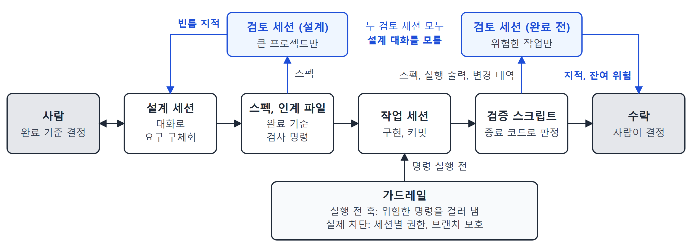
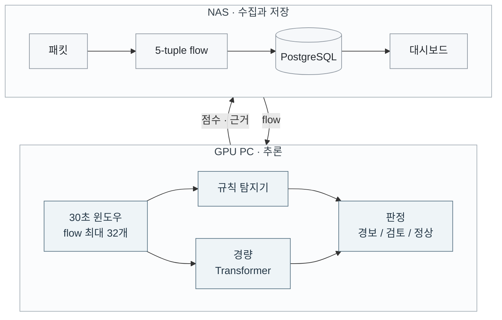

# 박길수

**ML / MLOps 엔지니어 · 보안 로그 이상탐지**

시스템 로그와 네트워크 로그에서 평소와 다른 행동을 찾는 모델을 만듭니다. 
모델만 만들고 끝내지 않고 수집, 서빙, 저장, 분석가 화면까지 연결합니다.

 

---

## 소개

웹 시스템 개발과 운영, ML 연구, 네트워크와 보안 공부를 차례로 거쳤고 지금은 이 경험을 보안 이상탐지 한 곳에 모아서 씁니다. 탐지 모델을 만드는 일과 그 모델을 운영하는 일을 나누지 않고 한 프로젝트 안에서 같이 합니다. 로그가 어떤 환경에서 왜 남는지 이해하고 문제와 평가 방법을 정하는 데서 시작해 평가에 쓴 전처리, 모델, 임계값이 운영에서도 똑같이 돌도록 묶어 배포하는 데까지 맡습니다.

| 시⁠기 | 내용 |
| --- | --- |
| 학⁠부 | 경영정보학을 전공해 프로그래밍, 데이터베이스 모델링, 시스템 분석과 설계를 배웠습니다. |
| 2⁠0⁠1⁠9 ~ 2⁠0⁠2⁠2 | 공공기관의 전자정부프레임워크(Spring, MyBatis) 시스템을 3년 3개월 유지보수했습니다. 내부망에서 WEB 서버와 WAS(JBoss)가 분리된 환경이었고 형상 관리는 SVN으로 했습니다. 기능 수정, 신규 게시판 개발, SQL 수정이 주된 일이었습니다. 접속이 몰리는 날에는 서버 자원 추이와 WAS 로그, 에러 로그를 확인했습니다. |
| 석⁠사 | 국민대학교 일반대학원에서 데이터사이언스를 전공했습니다. 운영하면서 로그를 읽던 경험이 연구 주제로 이어졌습니다. 로그가 발생하는 방식(시점, 몰림, 심각도)을 그래프 기반 로그 이상탐지의 인접행렬에 넣고 세 데이터셋에서 비교했습니다. |
| 지⁠금 | Zeek 네트워크 로그에서 내부 자산의 행동 이상을 찾는 파이프라인을 만듭니다. 수집, 탐지, LLM 조사, 관제 대시보드가 VMware 격리 실습망에서 5분 주기로 이어서 돌아갑니다. |

---

## 대표 프로젝트

### Zeek 네트워크 로그 이상탐지와 LLM 조사 에이전트 (zeek_AD)

rule로는 잡기 어려운 내부망의 행동 이상(정찰, 측면 이동, beaconing, 느린 유출)을 Zeek 로그에서 찾아 분석가가 조사할 순서를 매기는 시스템입니다. 정상 트래픽만 학습한 모델 세 가지가 점 이상, 문맥 이상, 관계 이상을 하나씩 맡습니다. 상위 후보에는 LLM 에이전트가 근거와 MITRE ATT&CK 기법 후보를 붙입니다.

문제 정의, 모델 구성, 평가 방법, 파이프라인 구조는 직접 설계했고 구현에는 AI 코딩 에이전트(Claude Code, Codex)를 활용했습니다. Transformer 모델과 시간 그래프 모델의 엣지 인코더, 임베딩, 디코더, 손실은 Jupyter 노트북에서 직접 작성했습니다.

| 항⁠목 | 내용 |
| --- | --- |
| 기⁠간 | 2026.11 ~ 현재 |
| 저⁠장⁠소 | [zeek_AD](https://github.com/prosild/zeek_AD) (탐지, 조사 에이전트), [zeek_ad_dashboard](https://github.com/prosild/zeek_ad_dashboard) (관제 대시보드) |
| 데⁠모 | [soc.psdev93.synology.me](https://soc.psdev93.synology.me) 읽기 전용 계정 `demo` / `WTYdSaRDUfjT3jr9cAw2` |
| 기⁠술 | Python, PyTorch, PyTorch Geometric, PySpark, Zeek, MLflow, LangGraph, PostgreSQL(pgvector), FastAPI, Spring Boot, Docker |

세 모델을 결합한 조사 순위는 공개 데이터의 공격 사건 16건 중 14건, APT 합성 패턴 20건 중 13건을 하루 상위 50건 안에 올렸습니다. 통계 베이스라인이 나흘 내내 놓친 HTTPS beaconing은 시간 그래프 모델이 사흘, 하루만 올린 측면 이동은 Transformer가 나흘 모두 상위 50에 올렸습니다. 세 모델의 순위를 번갈아 뽑는 방식이라 상위 10건에서는 모델마다 차지하는 자리가 줄어 가장 잘한 단일 모델보다 낮았습니다. 표본이 작아 모델 간 차이는 확정할 수 없습니다.

| 고민한 문제 | 선택 | 대가 |
| --- | --- | --- |
| 공격 대부분이 방화벽의 NAT 주소 하나에서 들어와 그 주소와의 연결 수로만 정렬해도 공격이 상위에 오름 | 이 정렬을 진단용 비교 기준으로 두고 모델이 주소가 아닌 행동을 보는지 확인 | 공개 데이터 수치로는 모델 우열을 가리지 않음 |
| 운영 환경에는 공격 라벨이 없고 분석가가 하루에 볼 수 있는 건수는 한정됨 | 정상 트래픽 하루치만 학습하고 F1 대신 상위 10건, 50건 안에 든 공격 사건 수(Recall@N)로 평가 | 전체 후보 중 오탐이 얼마나 되는지는 이 지표에 드러나지 않음 |
| 라벨이 없는 운영에서는 계산이 달라져도 알아챌 방법이 없음 | 모델, 전처리, 임계값, 코드 해시를 배포 묶음 하나로 MLflow Registry에 등록하고 평가 점수가 재현될 때만 통과 | 배포 전의 재현만 보장함. 운영 중 드리프트 감시와 새 환경에 맞춘 임계값 재설정은 하지 않음 |

모델별 결과와 나머지 설계 판단

 

Recall@N은 날마다 조사 후보 약 250건 중 상위 N건 안에 든 공격 사건 수를 전체 사건 수로 나눈 값입니다. 모델 가운데 가장 높은 값을 굵게 표시했습니다.

| 순위 기준 | 공개 @10 | 공개 @50 | APT 합성 @10 | APT 합성 @50 |
| --- | ---: | ---: | ---: | ---: |
| 통계 베이스라인 | 8/16 | 13/16 | **7/20** | 11/20 |
| Transformer | 8/16 | 11/16 | 4/20 | 11/20 |
| 시간 그래프 | **11/16** | 13/16 | 2/20 | 9/20 |
| 세 모델 결합 | 8/16 | **14/16** | 5/20 | **13/20** |
| NAT 주소 연결 수 (진단용) | 12/16 | 13/16 | 없음 | 없음 |

- 공개 데이터 상위 10에서는 NAT 진단 기준이 모든 모델보다 높았습니다. APT 합성 패턴은 내부 자산에서 출발하므로 이 편향과 무관합니다.
- APT 합성 상위 10에서는 통계 베이스라인이 가장 높았습니다. 그래도 딥러닝 모델 둘을 유지한 것은 베이스라인이 놓치는 beaconing과 측면 이동을 잡기 때문입니다.
- 놓친 XSS와 SQL 인젝션은 요청 내용에 드러나는 공격이라 URI와 페이로드를 보는 탐지와 함께 써야 합니다.

| 고민한 문제 | 선택 | 대가 |
| --- | --- | --- |
| CIC-IDS-2017의 CSV는 관제에서 쓰는 센서의 출력이 아니고 프로토콜 로그를 근거로 쓸 수도 없음 | 원본 PCAP 5일치(약 52GB)를 Zeek로 다시 처리 | 공격 사건 16건의 정답을 다시 구성 |
| 5분 단위로 집계하면 연결 상대가 사라짐 | 연결 하나하나를 이벤트로 다루는 시간 그래프 모델(TGN 구조)을 추가 | IP를 입력으로 쓰는 모델이라 NAT 주소에 기댐. NAT 연결을 빼면 공개 데이터 상위 10이 11/16에서 6/16으로 내려감 |
| 세 모델의 점수는 분포의 꼬리 모양이 달라 정규화해서 섞으면 한 모델이 상위를 거의 독차지함 | 점수를 섞지 않고 순위를 번갈아 뽑아 결합(round-robin) | 상위 N 자리가 모델 수만큼 나뉨 |
| 공개 데이터의 공격은 대부분 시끄러운 스크립트 공격 | 조용히 오래가는 APT 합성 패턴 5종 20건을 실제 배경 로그에 주입해 따로 평가 | 패턴 설정을 모델 점수를 보기 전에 고정해야 함 |

Zeek는 연결이 끝난 뒤에 기록을 남깁니다. 연결 시작 시각으로 윈도우를 나누면 그 시점에는 없던 기록이 섞이므로 기록 시각을 기준으로 5분 윈도우를 나눴습니다.

LLM 조사 에이전트와 운영

 

LLM은 탐지에 쓰지 않고 상위 후보를 조사하는 데만 씁니다. 근거 수집, ATT&CK 기법 검색, 보고서 작성 순서로 LangGraph에 구성했습니다. ATT&CK 검색은 같은 질의 16개로 BM25와 임베딩 검색(pgvector)을 비교해 hit@5가 높은 임베딩을 골랐습니다(0.750 대 0.938).

- 도메인이나 URI처럼 공격자가 조작할 수 있는 문자열은 간접 프롬프트 인젝션 경로가 되므로 LLM에 넘기지 않습니다. 실제 IP는 외부 API로 나가지 않게 가명 식별자로 바꾸고 허용 목록에 있는 수치만 전달합니다.
- 출력의 수치와 ATT&CK ID는 코드로 입력 근거와 대조해서 어긋나면 템플릿 보고서로 바꿉니다(평가용 30건 중 28건 통과).
- 알림 피로를 줄이려고 어떤 후보를 바로 알릴지 LLM 판단에 맡기는 구조를 시험했습니다. 정해 둔 전송 규칙과 나란히 돌려 보니 알림은 29건에서 16건으로 줄었지만 공격 관련 26건 중 11건이 검토나 보류로 밀려서 전송 규칙을 유지했습니다.

운영 쪽에서는 배포 묶음의 교체, 롤백, 재교체를 실제 추론으로 확인했고 처리 도중에 worker를 강제 종료하는 장애 복구 시험 9건을 모두 통과했습니다. 실시간 처리에는 Spark Structured Streaming 대신 파일 단위 마이크로배치를 써서 평가 때와 같은 배치 스크립트로 그날을 다시 계산합니다.

VMware 격리 실습망에서는 수집부터 조사 에이전트까지 5분 주기로 자동 실행했고 Kali 포트 스캔이 탐지부터 보고서까지 이어지는 것을 확인했습니다. 분석가용 대시보드(Spring Boot)에는 역할별 권한, 마스킹, 감사 로그를 적용했습니다. 운영망 데이터로는 검증하지 못했습니다.

---

## 지금 하는 일

- SKT ALEPH 과정(K-뉴딜 아카데미)에서 보안 운영을 배웁니다. 2026년 12월까지이고 실습 코드는 [security-agent-toolkit](https://github.com/prosild/security-agent-toolkit)에 있습니다.
- zeek_AD와 석사 논문 연구는 한 탐지 체계의 두 단계로 구상했습니다. 네트워크 로그에서 이상 행동이 보인 자산을 먼저 찾고 그 자산의 시스템 로그를 그래프 기반 로그 이상탐지로 확인하는 구조입니다. 두 단계를 잇는 부분은 아직 구현하지 않았습니다.
- AWS와 Kubernetes 배포는 zeek_AD의 범위에서 빼고 다음 프로젝트로 미뤘습니다.

---

## 석사 논문 연구

같은 로그 메시지라도 언제 발생했는지, 얼마나 몰려서 나왔는지, 얼마나 심각한지에 따라 시스템 상태를 다르게 알려 준다는 전제에서 출발했습니다.

여러 작업의 로그가 뒤섞여 기록되는 환경에서 그래프 신경망 기반 로그 이상탐지 모델(Lograph)의 로그 사이 연결 가중치(인접행렬)를 정하는 방식에 따라 탐지 성능이 얼마나 달라지는지 통제 실험으로 비교했습니다. 세 데이터셋 모두에서 기준 모델보다 F1이 높았던 설계는 시간 가중뿐이었습니다. 향상 폭이 작아 경향으로만 해석했습니다.

연구 내용 펼치기 (동기, 인접행렬 설계, 결과)

 

Lograph는 로그 내용과 함께 공유 엔티티(ID, 주소, 컴포넌트)로 이어지는 로그 사이의 관계를 로그-엔티티 그래프에서 학습합니다. 그런데 두 로그의 연결 강도는 공유하는 엔티티 수만으로 정합니다. 로그 사이의 시간 간격, 로그가 몰리는 정도, 심각도 같은 운영 맥락이 빠져 있고 연결이 지나치게 촘촘해집니다.

이 빈자리를 하나씩 채우는 인접행렬 설계 네 가지를 만들었습니다. 어느 설계의 효과인지 가려내려고 데이터, 분할, 모델, 학습 설정은 그대로 두고 인접행렬 생성 단계만 바꿨습니다.

| 설계 | 담는 질문 | 방법 |
| --- | --- | --- |
| 시⁠간 가⁠중 | 두 로그가 언제 발생했나 | 시간이 가까운 로그일수록 강하게 연결 |
| 버⁠스⁠트 점⁠수 | 로그가 얼마나 몰려서 나왔나 | 짧은 시간에 로그가 몰린 구간을 강조. 상태 변화나 장애 근처에서 자주 나타남 |
| 로⁠그 레⁠벨 가⁠중 | 로그가 얼마나 심각했나 | 심각도에 따라 가중 (DEBUG 0.8 → FATAL 2.0) |
| T⁠o⁠p⁠-⁠k 희⁠소⁠화 | 어떤 연결이 중요한가 | 로그마다 강한 연결만 남겨 촘촘하고 잡음 많은 연결을 제거 |

F1-score입니다. 설정마다 한 번씩 실행했고 데이터셋별 최고값을 굵게 표시했습니다.

| 데이터셋 | 기준 모델 | 시간 가중 | 버스트 | 로그 레벨 | Top-k |
| --- | ---: | ---: | ---: | ---: | ---: |
| BGL | 0.9268 | **0.9307** | 0.9263 | 0.9230 | 0.9094 |
| Thunderbird | 0.9580 | 0.9602 | **0.9769** | 0.9630 | 0.9588 |
| HDFS | 0.8174 | 0.8282 | 0.8178 | 0.8172 | **0.8342** |

- 시간 가중을 뺀 나머지 설계는 데이터셋마다 결과가 갈렸습니다. 인접 구조의 효과는 데이터 특성에 좌우된다고 결론지었습니다.
- 반복 실행으로 평균과 표준편차를 내는 것과 여러 신호를 결합하는 것은 다음 과제로 남겼습니다.

*인터리빙 환경에서 로그-엔티티 그래프 인접 구조 설계의 비교 분석*, 석사학위 논문, 국민대학교 일반대학원 데이터사이언스 전공, 2026 ([RISS](https://www.riss.kr/link?id=T17372490))

연구 질문은 연구실 세미나에서 로그 이상탐지 논문 11편을 리뷰하다가 나왔습니다. DeepLog와 LogRobust에서 시작해 Transformer 계열(HitAnomaly, LAnoBERT, LogFormer)을 거쳐 Lograph까지 읽으며 논문마다 무엇을 놓치는지 따라갔습니다. 파싱에서 사라지는 정보, 처음 보는 로그, 분포 변화가 차례로 나왔고 마지막이 여러 작업의 로그가 한 타임라인에 뒤섞이는 문제였습니다. 리뷰는 [Notion](https://www.notion.so/3f3fdb93808981e7a90ecf5ce7be3795)에 정리해 두었습니다.

---

## AI 코딩 에이전트 작업 체계 (agent-kit)

AI에 구현을 맡길 때 사람이 정할 것과 확인할 것을 원칙으로 정리하고 이를 지침, 검증 스크립트, 실행 전 훅으로 옮긴 개인용 작업 체계입니다. 규칙을 늘리면 정상 작업까지 막히고 줄이면 결과를 믿기 어려워서 여러 번 고쳤습니다. 지금은 실제로 실패를 겪은 경우에만 차단 규칙을 두고 결과는 구현한 세션 밖에서 검증 스크립트와 별도 검토 세션으로 확인합니다.

| 원⁠칙 | 구현 |
| --- | --- |
| 만⁠든 쪽⁠과 확⁠인⁠하⁠는 쪽⁠을 나⁠눈⁠다 | 설계 대화를 모르는 별도 세션이 설계 단계에서는 스펙의 빈틈을 찾고 완료 전에는 실행 출력과 변경 내역을 읽어 결과를 검토 |
| 완⁠료⁠는 실⁠행⁠한 근⁠거⁠로 판⁠단⁠한⁠다 | 작업 세션의 보고 대신 검증 스크립트가 검사 명령을 직접 실행해 종료 코드, 테스트 실행 여부, 커밋되지 않은 변경으로 판정 |
| 사⁠람⁠이 정⁠하⁠는 것⁠은 사⁠람⁠에⁠게 남⁠긴⁠다 | 완료 기준, 목표와 범위 변경, 절충, 되돌리기 어려운 일, 잔여 위험 수락은 사람이 결정 |
| 가⁠볍⁠게 유⁠지⁠한⁠다 | 금지와 절차 규칙은 실제로 겪은 실패를 막을 때만 두고 규칙을 늘릴 때는 중복과 옛 규칙을 함께 덜어냄 |
| 검⁠토⁠와 승⁠인⁠은 위⁠험⁠과 크⁠기⁠에 비⁠례⁠한⁠다 | 작은 작업은 검토 없이 바로 맡김. 무거운 프로젝트는 설계 전체의 빈틈 검토를 받고 보안, 권한, 데이터 무결성, 외부 배포 작업은 완료 전 검토까지 받음 |
| 금⁠지⁠는 훅⁠으⁠로⁠, 강⁠제⁠는 권⁠한⁠으⁠로 | 실행 전 훅은 실제로 일어난 실수만 막고 실제 차단은 세션별 권한과 브랜치 보호에 맡김 |
| 상⁠태⁠와 기⁠억⁠은 파⁠일⁠에 둔⁠다 | 진행 상태와 결정 이유를 파일에 남겨 세션이나 모델을 바꿔도 이어서 진행 |
| 설⁠계⁠자⁠의 주⁠의⁠력⁠이 가⁠장 귀⁠하⁠다 | 항상 읽는 지침은 14KB 이하로 두고 절차, 예외, 회고는 필요할 때만 읽는 문서로 분리 |

독립 검토 구조는 Google이 공개한 EGM을 따랐습니다. 겪은 실패를 작업 체계의 문제와 그 프로젝트만의 문제로 나누는 구분은 Google Research의 Harness²에서 가져왔습니다.

zeek_AD 대시보드를 만들 때는 검토 세션의 지적으로 두 가지를 고쳤습니다. 클라이언트 헤더를 그대로 믿어 감사 로그의 접속 IP를 위조할 수 있던 문제와 낮은 권한 계정에 사용자 이름이 노출될 수 있던 경로입니다.

---

## 이전 프로젝트

### NetFlow 포트 스캔 탐지

패킷 수집에서 대시보드까지 이어지는 탐지 시스템입니다. 명시적인 스캔 규칙과 30초 flow 윈도우를 분류하는 경량 Transformer를 함께 씁니다. 수집과 저장은 NAS에서 상시로 돌리고 학습과 추론은 GPU PC에서 하도록 나눴습니다. CIDDS-002 Week2에서 F1 89.07%가 나왔습니다.

| 항⁠목 | 내용 |
| --- | --- |
| 저⁠장⁠소 | [netflow_portscan_detection](https://github.com/prosild/netflow_portscan_detection) (탐지), [NexusPortal](https://github.com/prosild/NexusPortal) (대시보드) |
| 데⁠모 | [psdev93.synology.me/portfolio/portscan](https://psdev93.synology.me/portfolio/portscan) 기록해 둔 실험 결과를 보여 주는 읽기 전용 화면이고 표시된 데이터의 시각이 함께 나옵니다 |

구조, 설계 결정, 평가 결과 펼치기

 

만든 것은 Scapy 패킷 수집과 5-tuple flow 집계, 캡처와 DB 쓰기를 분리하는 큐와 배치 writer, 출발지별 윈도우, 규칙 탐지기, Transformer 인코더(PyTorch), FastAPI 추론, flow와 점수와 규칙 근거를 저장하는 PostgreSQL, Spring Boot 대시보드입니다.

- 평가에 누수가 없도록 정규화는 Week1 학습 구간에만 맞췄습니다. Week1은 학습과 검증에, Week2는 테스트에 썼습니다.
- flow를 출발지 IP별로 30초 윈도우(최대 32개)로 묶어 판단 단위로 삼았습니다. 모델이 flow 하나가 아닌 스캔 행동을 보게 하려는 선택입니다.
- 규칙과 모델에 다른 역할을 줬습니다. 규칙은 뚜렷한 시그니처를 빠르게 잡고 모델은 고정 임계값이 놓치는 느린 스캔과 변형된 스캔을 맡습니다.
- 모델은 FlowTransformer 방식의 시퀀스 모델링을 참고해 단순화했습니다. 원 논문을 재현한 것은 아닙니다.

CIDDS-002 Week2 평가 결과입니다.

| 방법 | Precision | Recall | F1 |
| --- | ---: | ---: | ---: |
| 규칙 탐지기 | 79.16% | 50.08% | 61.35% |
| 경량 Transformer | 87.86% | 89.47% | 88.66% |
| **Transformer + 명시적 스캔 규칙** | **87.93%** | **90.24%** | **89.07%** |

CIDDS-002는 모의 환경에서 만든 데이터입니다. 실제 트래픽에서 오탐률과 지연을 재는 평가는 하지 않았습니다.

---

## 기술 스택

| 영⁠역 | 기술 |
| --- | --- |
| ML / Data | Python, PyTorch, PyTorch Geometric, scikit-learn, PySpark, pandas, NumPy |
| Network | Zeek, Scapy, tcpdump |
| MLOps / Serving | MLflow, FastAPI, Docker, Docker Compose |
| LLM | LangGraph, pgvector |
| Database | PostgreSQL |
| Backend | Java, Spring Boot, MyBatis, SQL |
| Infra | Linux, Git, VMware, Synology NAS |

---

## 관심 분야

로그와 네트워크 이상탐지, 운영 데이터의 그래프 학습, 분포 변화에 강건한 모델, 보안 관제에 쓰는 재현 가능한 ML 파이프라인과 서빙과 모니터링
